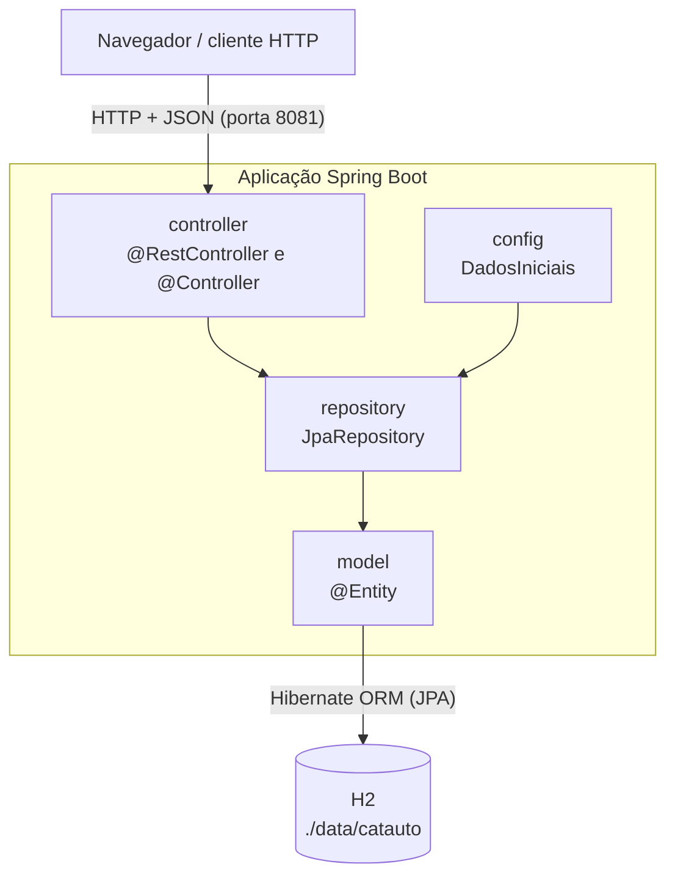
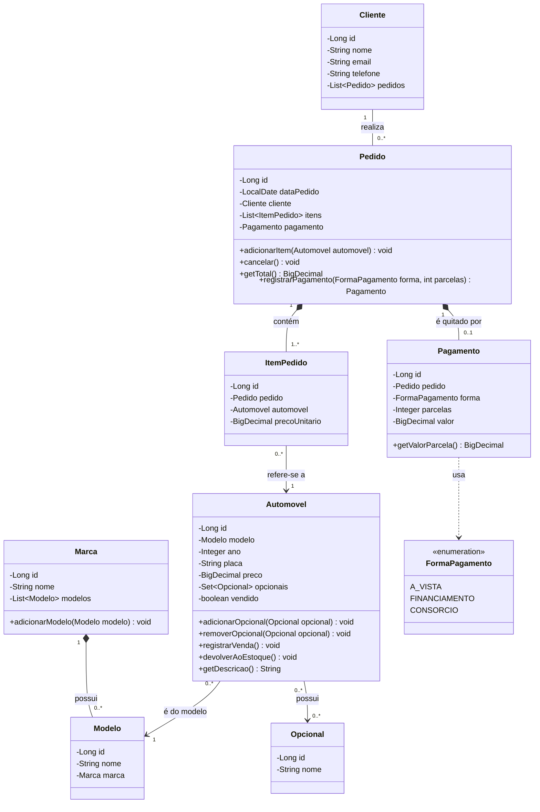
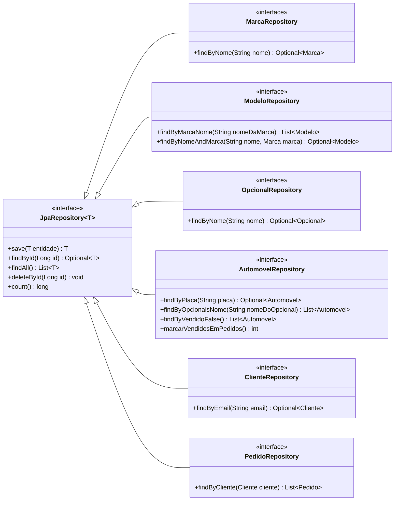
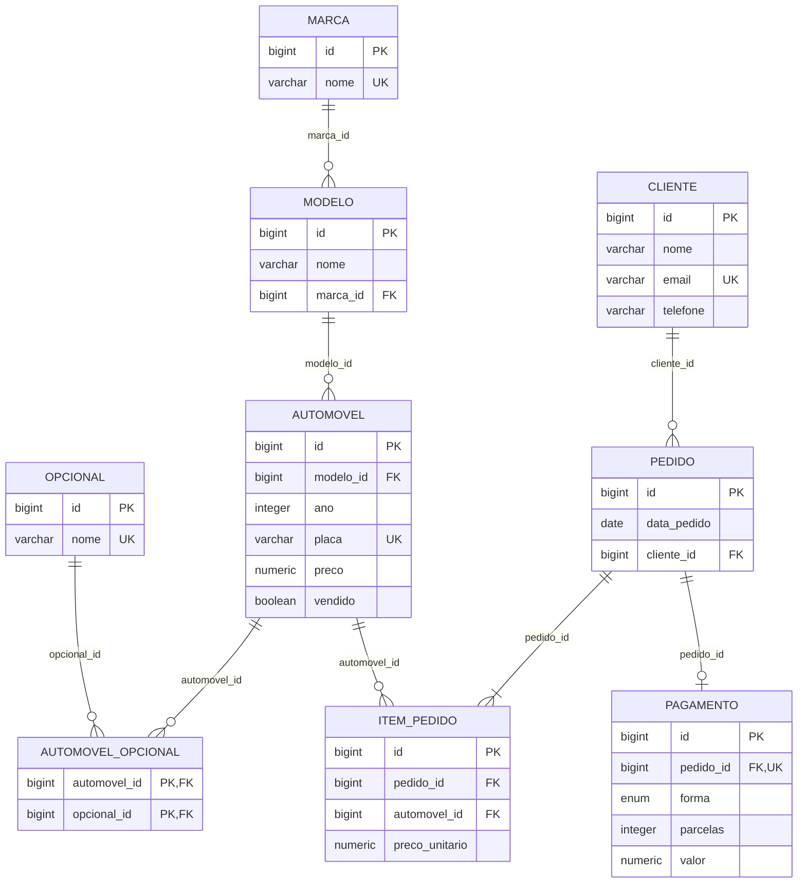

# CatAuto — Documento de Concepção, Requisitos e Modelagem de Dados

**Etapa 1** — Fundamentação arquitetural, levantamento de requisitos, modelagem conceitual e camada de persistência

| | |
|---|---|
| Disciplina | _(preencher)_ |
| Professor(a) | _(preencher)_ |
| Entrega | 26/10/2026, 23h59 |
| Versão do documento | 1.0 |

---

## Identificação da Equipe

Máximo de 5 integrantes, sendo 1 líder.

| Papel | Nome completo | Matrícula (RA) |
|-------|---------------|----------------|
| **Líder** | _(preencher)_ | _(preencher)_ |
| Integrante | _(preencher)_ | _(preencher)_ |
| Integrante | _(preencher)_ | _(preencher)_ |
| Integrante | _(preencher)_ | _(preencher)_ |
| Integrante | _(preencher)_ | _(preencher)_ |

| Item | Link |
|------|------|
| Repositório Git (código-fonte) | _(preencher: `https://github.com/<usuario>/<repositorio>`)_ |
| Aplicação | Execução local em `http://localhost:8081` (instruções no Apêndice C) |

---

## Sumário

1. Visão Geral do Projeto
   - 1.1 Nome do Produto
   - 1.2 Declaração do Problema e Justificativa
   - 1.3 Público-Alvo e Objetivos do Sistema
2. Especificação de Requisitos
   - 2.1 Requisitos Funcionais (RF01 a RF11)
   - 2.2 Requisitos Não Funcionais (RNF01 a RNF10)
3. Arquitetura e Modelagem de Dados
   - 3.1 Diagrama de Classes UML
   - 3.2 Mapeamento de Entidades JPA e Dicionário de Dados
- Apêndice A — Matriz de rastreabilidade e exemplos da API
- Apêndice B — Script DDL gerado pelo Hibernate
- Apêndice C — Como executar e testar
- Apêndice D — Limitações conhecidas e evoluções previstas

---

## 1. Visão Geral do Projeto

### 1.1 Nome do Produto

**CatAuto** — Sistema de Catálogo de Automóveis e Pedidos de Venda.

| Item | Valor |
|------|-------|
| Nome comercial | CatAuto |
| Nome técnico (artefato Maven) | `br.org.catolicasc:automoveis:0.0.1-SNAPSHOT` |
| Pacote base | `br.org.catolicasc.automoveis` |
| Tecnologias | Java 17 · Spring Boot 4.1.1 (Spring Framework 7.0) · Spring Data JPA com Hibernate ORM 7.4 · H2 Database 2.4 · Thymeleaf · Maven (Maven Wrapper) |

### 1.2 Declaração do Problema e Justificativa

**Contexto do problema.** Revendas de veículos de pequeno porte costumam controlar o estoque, os
clientes e as vendas em planilhas ou cadernos. Isso gera:

- **dados duplicados e inconsistentes**: a mesma marca escrita de formas diferentes, dois veículos
  cadastrados com a mesma placa, clientes repetidos;
- **dificuldade de consulta**: perguntas simples como "quais modelos da GM temos?" ou "quais carros
  têm airbag?" exigem procurar linha por linha;
- **perda do histórico de vendas**: quando o preço de um veículo muda, o valor das vendas antigas se
  perde, e a forma de pagamento combinada (à vista, financiamento, consórcio) fica registrada só em papel.

**Justificativa.** Um banco de dados relacional com regras de integridade (chaves primárias e
estrangeiras, campos obrigatórios e valores únicos) elimina as duplicidades e padroniza o catálogo. Guardar
o preço de cada item no momento da venda preserva o histórico. Expor as operações por uma **API REST**
separa o back-end da interface: o mesmo serviço atende o painel web incluído no projeto, um futuro
aplicativo mobile ou integrações com financeiras.

**Proposta de valor da solução.**

- Catálogo padronizado em três níveis (**Marca → Modelo → Automóvel**), com **opcionais** pesquisáveis.
- Venda registrada com o **preço congelado por item** e o **pagamento** (à vista, financiamento ou consórcio),
  com cálculo automático do valor da parcela.
- **API REST** em JSON, com códigos HTTP padronizados, pronta para qualquer front-end.
- **Custo zero de infraestrutura** nesta fase (banco H2 embarcado), com migração para PostgreSQL ou
  MySQL sem alterar as entidades, já que o mapeamento segue o padrão JPA.

### 1.3 Público-Alvo e Objetivos do Sistema

**Público-alvo**

| Perfil | Necessidade atendida |
|--------|----------------------|
| Vendedor / atendente da revenda | Consultar veículos e opcionais, cadastrar clientes, registrar pedidos e pagamentos |
| Gerente da revenda | Manter o catálogo (marcas, modelos, veículos, preços, opcionais) e acompanhar os pedidos por cliente |
| Desenvolvedor de front-end ou de integrações | Consumir uma API REST estável, em JSON, com respostas e erros padronizados |

**Objetivo geral.** Oferecer cadastro e consulta padronizados de veículos, clientes, pedidos e pagamentos,
com persistência confiável em banco relacional e exposição das operações por uma API REST.

**Objetivos específicos**

1. Padronizar o catálogo em marca, modelo e automóvel, com opcionais associados a cada automóvel.
2. Manter o cadastro de clientes com e-mail único.
3. Registrar pedidos com um ou mais automóveis, congelando o preço de cada item e calculando o total.
4. Registrar o pagamento de cada pedido, validando a forma de pagamento e o número de parcelas.
5. Garantir a integridade dos dados com restrições declaradas no banco (PK, FK, NOT NULL, UNIQUE).
6. Expor todas as operações por endpoints REST com os códigos HTTP corretos.
7. Persistir os dados em arquivo, para que sobrevivam ao reinício do servidor.

---

## 2. Especificação de Requisitos

### 2.1 Requisitos Funcionais (RF)

Prioridade: **Essencial** (sem ele o sistema não cumpre seu objetivo) · **Importante** · **Desejável**.

| ID | Requisito | Descrição detalhada | Prioridade |
|----|-----------|---------------------|------------|
| RF01 | Gerenciar marcas | O sistema deve permitir criar, listar, consultar por id, atualizar e remover marcas (ex.: GM, HONDA, TOYOTA). O nome é obrigatório e único. Ao remover uma marca, seus modelos são removidos em cascata; se algum desses modelos estiver em uso por um automóvel, a remoção é recusada (HTTP 409). | Essencial |
| RF02 | Gerenciar modelos | O sistema deve permitir criar, listar, consultar, atualizar e remover modelos, sempre vinculados a uma marca existente (marca ausente ou inexistente → 400). A listagem pode ser filtrada pelo nome da marca (`?marca=GM`). | Essencial |
| RF03 | Gerenciar opcionais | O sistema deve permitir criar, listar, consultar, atualizar e remover itens opcionais (ex.: ar-condicionado, airbag, câmera de ré). O nome é obrigatório e único. Um opcional associado a algum automóvel não pode ser removido (409). | Importante |
| RF04 | Gerenciar automóveis | O sistema deve permitir criar, listar, consultar, atualizar e remover automóveis, informando marca, modelo, ano, placa, preço e a lista de opcionais. Marca e modelo são digitados pelo nome: se já existirem são reaproveitados (sem diferenciar maiúsculas de minúsculas); se não existirem, são cadastrados automaticamente. A placa é obrigatória e única. Deve ser possível consultar por placa e filtrar a listagem por opcional (`?opcional=Airbag`). A listagem mostra apenas o **estoque** (automóveis não vendidos); `?incluirVendidos=true` lista também os vendidos. Um automóvel que consta em algum pedido não pode ser removido (409). | Essencial |
| RF05 | Gerenciar clientes | O sistema deve permitir criar, listar, consultar, atualizar e remover clientes (nome, e-mail e telefone). Nome e e-mail são obrigatórios e o e-mail é único. Um cliente com pedidos não pode ser removido (409). | Essencial |
| RF06 | Registrar pedido de venda | O sistema deve criar um pedido para um cliente existente com um ou mais automóveis. A data do pedido é a data do dia. O preço de cada item é copiado do automóvel no momento da venda, de modo que alterações posteriores de preço não afetam pedidos já feitos. O total é a soma dos itens. Um pedido sem automóveis, ou com cliente ou automóvel inexistente, é rejeitado (400). Cada automóvel vendido é marcado como vendido e **sai do estoque**; tentar vender um automóvel já vendido é rejeitado (409). | Essencial |
| RF07 | Registrar pagamento do pedido | Todo pedido criado recebe exatamente um pagamento, com forma (**À vista**, **Financiamento** ou **Consórcio**), número de parcelas e valor igual ao total do pedido. Regras: parcelas ≥ 1; pagamento à vista somente em 1 parcela; sem forma informada, assume-se à vista em 1 parcela. O sistema calcula o valor de cada parcela (2 casas decimais, arredondamento bancário HALF_EVEN). Violação de regra → 400 com mensagem explicativa. | Essencial |
| RF08 | Consultar pedidos | O sistema deve listar todos os pedidos, consultar um pedido por id (com itens, preços, total e pagamento) e filtrar os pedidos de um cliente (`?clienteId=`). | Essencial |
| RF09 | Cancelar pedido | O sistema deve permitir remover um pedido; seus itens e seu pagamento são removidos junto (cascata + `orphanRemoval`), mantendo o cliente e os automóveis, que **voltam ao estoque**. | Importante |
| RF10 | Painel web | O sistema deve oferecer uma página HTML (`GET /`) com indicadores (automóveis em estoque, clientes e pedidos), os veículos em estoque com seus opcionais, cadastro de automóveis com marca e modelo digitados livremente (com sugestões dos já cadastrados), cadastro e exclusão de automóveis, clientes e pedidos, e registro de pedidos com escolha da forma de pagamento. A página consome a própria API REST. | Desejável |
| RF11 | Carga inicial de dados | Na primeira execução (banco vazio), o sistema deve carregar marcas, modelos, automóveis e opcionais de exemplo. Execuções seguintes não duplicam esses dados. | Desejável |

> **Fora do escopo da Etapa 1:** autenticação de usuários. Está prevista como evolução (ver RNF02 e Apêndice D).

### 2.2 Requisitos Não Funcionais (RNF)

| ID | Categoria | Requisito (definição técnica) | Como é atendido | Situação |
|----|-----------|-------------------------------|-----------------|----------|
| RNF01 | **Desempenho** | As operações de cadastro e as listagens devem responder em até 1 s (meta: < 500 ms) com até 10.000 automóveis e 50.000 pedidos, em uma máquina de desenvolvimento comum. | Índices criados pelo banco para todas as PK, FK e colunas UNIQUE (placa, e-mail, nomes); associações `@ManyToOne(fetch = LAZY)` onde a carga imediata é desnecessária; `hibernate.default_batch_fetch_size=50` para carregar associações em lote e evitar o problema N+1; pool de conexões HikariCP; DTOs trafegando apenas os campos necessários. | Implementado (meta ainda não medida com carga real; paginação prevista no Apêndice D) |
| RNF02 | **Segurança** | Proteger a integridade e a confidencialidade dos dados e reduzir a superfície de ataque da aplicação. | **(a)** Todo acesso ao banco passa pelo Spring Data JPA/Hibernate com *prepared statements* (consultas parametrizadas), o que previne SQL Injection. **(b)** A API recebe e devolve DTOs (`record`), nunca entidades, o que impede *mass assignment* (o cliente não consegue alterar campos não previstos, como `id` ou o preço congelado do item). **(c)** Saída escapada: o Thymeleaf (`th:text`) e a função `esc()` do painel escapam HTML, prevenindo XSS. **(d)** Respostas de erro sem *stack trace*; erros de negócio retornam `{"erro": "..."}`. **(e)** Exposição mínima: o Actuator expõe apenas `/actuator/health` e o console H2 só aceita conexões da própria máquina (padrão `web-allow-others=false`). **(f)** Credenciais do banco podem vir de variáveis de ambiente (`DB_USERNAME`, `DB_PASSWORD`). | Parcial: (a)–(f) implementados. Autenticação/autorização com Spring Security (perfis GERENTE e VENDEDOR), senhas com hash BCrypt, HTTPS e desativação do console H2 fora do desenvolvimento estão previstos para a Etapa 2. |
| RNF03 | **Banco de dados** | Usar SGBD relacional com integridade referencial e restrições declarativas; os dados devem sobreviver ao reinício; os testes devem rodar isolados do banco real. | H2 2.4 em modo arquivo (`jdbc:h2:file:./data/catauto`). Esquema gerado e atualizado pelo Hibernate (`ddl-auto=update`) a partir das anotações. Restrições PK (IDENTITY), FK, NOT NULL, UNIQUE e ENUM declaradas nas entidades (ver 3.2). Valores monetários em `NUMERIC(12,2)` com `BigDecimal`, nunca `double`. Testes usam H2 em memória (`create-drop`). Trocar para PostgreSQL/MySQL exige apenas mudar o driver e a URL. | Implementado |
| RNF04 | **Padrões REST** | A API deve seguir as convenções REST de recursos, verbos, representações e códigos de status. | Recursos no plural sob `/api` (`/marcas`, `/modelos`, `/opcionais`, `/automoveis`, `/clientes`, `/pedidos`); identificador no caminho (`/{id}`) e filtros na *query string* (`?marca=`, `?opcional=`, `?incluirVendidos=`, `?clienteId=`). Verbos: GET (consulta, seguro e idempotente), POST (criação), PUT (substituição completa, idempotente), DELETE (remoção). Corpo em JSON (`application/json`), datas no formato ISO-8601 (`2026-10-24`), enums como texto (`"FINANCIAMENTO"`). Status: **200** OK, **201** Created (retorna o recurso criado), **204** No Content (remoção), **400** Bad Request (dado inválido ou regra violada), **404** Not Found, **409** Conflict (valor duplicado, registro em uso ou automóvel já vendido). API sem estado (*stateless*). | Implementado |
| RNF05 | Persistência | O acesso a dados deve ser feito exclusivamente com Spring Data JPA, sem SQL nativo. | Repositórios `JpaRepository<Entidade, Long>`; consultas derivadas do nome do método (ex.: `findByOpcionaisNome`, `findByVendidoFalse`); uma atualização em lote em JPQL (`@Query` + `@Modifying`); mapeamento objeto-relacional por anotações Jakarta Persistence; operações de escrita compostas executadas em transação (`@Transactional`). | Implementado |
| RNF06 | Arquitetura | O código deve ser organizado em camadas com responsabilidades separadas. | Pacotes `model` (entidades e regras de domínio), `repository` (acesso a dados), `controller` (API REST, página MVC e tratamento de erros) e `config` (carga inicial). Ver início da seção 3. | Implementado |
| RNF07 | Observabilidade | Deve ser possível verificar a saúde da aplicação e inspecionar os dados em desenvolvimento. | Spring Boot Actuator (`/actuator/health`) e console do H2 (`/h2-console`). | Implementado |
| RNF08 | Portabilidade e implantação | A aplicação deve rodar em qualquer sistema operacional com Java 17, sem instalar Maven ou banco de dados. | Maven Wrapper (`mvnw` / `mvnw.cmd`), JAR executável com servidor Tomcat embarcado, banco H2 embarcado, porta configurável (`server.port=8081`). | Implementado |
| RNF09 | Qualidade | As regras de persistência e da API devem ser verificadas por testes automatizados. | 55 testes JUnit 5 + Spring Boot Test cobrindo entidades e relacionamentos (`@DataJpaTest`), repositórios, controller MVC e API REST (MockMvc), executados com `mvnw test`. | Implementado |
| RNF10 | Usabilidade | O painel web deve ser utilizável em desktop e celular e informar o resultado de cada ação. | Layout responsivo (adapta-se a telas de até 720 px), mensagens de sucesso/erro exibidas na tela, confirmação antes de excluir. | Implementado |

---

## 3. Arquitetura e Modelagem de Dados

A aplicação é um monólito Spring Boot em camadas. O navegador (ou qualquer cliente HTTP) chama os
controllers; os controllers usam os repositórios; os repositórios persistem as entidades no banco via Hibernate.



| Pacote | Responsabilidade | Classes |
|--------|------------------|---------|
| `model` | Entidades JPA e regras de domínio | `Marca`, `Modelo`, `Opcional`, `Automovel`, `Cliente`, `Pedido`, `ItemPedido`, `Pagamento`, `FormaPagamento` (enum) |
| `repository` | Acesso a dados com Spring Data JPA | `MarcaRepository`, `ModeloRepository`, `OpcionalRepository`, `AutomovelRepository`, `ClienteRepository`, `PedidoRepository` |
| `controller` | API REST, página Thymeleaf e tratamento de erros | `MarcaApiController`, `ModeloApiController`, `OpcionalApiController`, `AutomovelApiController`, `ClienteApiController`, `PedidoApiController`, `AutomovelController`, `ApiExceptionHandler` |
| `config` | Carga inicial de dados | `DadosIniciais` |

### 3.1 Diagrama de Classes UML

O domínio tem dois módulos: **Catálogo** (Marca, Modelo, Automovel, Opcional) e **Vendas** (Cliente,
Pedido, ItemPedido, Pagamento). Eles se ligam pelo `ItemPedido`, pois o automóvel é o produto vendido.

Notação: `-` privado, `+` público; losango cheio (`*--`) = composição (a parte não existe sem o todo e é
persistida/removida em cascata); seta (`-->`) = associação navegável num só sentido; linha simples (`--`) =
associação bidirecional; multiplicidade em cada extremidade. Construtores, getters e setters foram omitidos.



**Relacionamentos e cardinalidades**

| Relação | Tipo | Multiplicidade | Navegação | Mapeamento JPA |
|---------|------|----------------|-----------|----------------|
| Marca — Modelo | 1:N (composição) | 1 — 0..* | bidirecional | `Marca.modelos`: `@OneToMany(mappedBy = "marca", cascade = ALL)` · `Modelo.marca`: `@ManyToOne` + `@JoinColumn(name = "marca_id", nullable = false)` |
| Modelo — Automovel | 1:N | 1 — 0..* | unidirecional (Automovel → Modelo) | `Automovel.modelo`: `@ManyToOne` + `@JoinColumn(name = "modelo_id", nullable = false)` |
| **Automovel — Opcional** | **N:M** | 0..* — 0..* | unidirecional (Automovel → Opcional) | `Automovel.opcionais`: `@ManyToMany` + `@JoinTable(name = "automovel_opcional", joinColumns = automovel_id, inverseJoinColumns = opcional_id)` + `@OrderBy("nome")` |
| Cliente — Pedido | 1:N | 1 — 0..* | bidirecional | `Cliente.pedidos`: `@OneToMany(mappedBy = "cliente")` · `Pedido.cliente`: `@ManyToOne(fetch = LAZY)` + `@JoinColumn(name = "cliente_id", nullable = false)` |
| Pedido — ItemPedido | 1:N (composição) | 1 — 1..* | bidirecional | `Pedido.itens`: `@OneToMany(mappedBy = "pedido", cascade = ALL, orphanRemoval = true)` · `ItemPedido.pedido`: `@ManyToOne(fetch = LAZY)` + `@JoinColumn(nullable = false)` |
| Automovel — ItemPedido | 1:N | 1 — 0..* | unidirecional (ItemPedido → Automovel) | `ItemPedido.automovel`: `@ManyToOne` + `@JoinColumn(name = "automovel_id", nullable = false)` |
| **Pedido — Pagamento** | **1:1** (composição) | 1 — 0..1 | bidirecional | `Pedido.pagamento`: `@OneToOne(mappedBy = "pedido", cascade = ALL, orphanRemoval = true)` · `Pagamento.pedido`: `@OneToOne(optional = false)` + `@JoinColumn(name = "pedido_id", nullable = false, unique = true)` |
| Pedido — Automovel | N:M com atributo | 0..* — 0..* | via `ItemPedido` | Resolvida pela entidade associativa `ItemPedido` (ver observação abaixo) |

Observações sobre as cardinalidades:

- **Duas formas de N:M.** *Automóvel × Opcional* é uma associação pura, sem dados próprios, por isso usa
  `@ManyToMany` com tabela de junção. *Pedido × Automóvel* tem um dado da própria venda, o preço no momento
  da compra (`precoUnitario`), por isso foi modelada como a entidade `ItemPedido`, com duas relações 1:N.
- **1:1 Pedido — Pagamento.** A chave estrangeira fica em `pagamento.pedido_id` com restrição `UNIQUE`, o que
  garante no banco que um pedido tem no máximo um pagamento. Todo pagamento pertence a exatamente um pedido
  (`optional = false`). Pela API, todo pedido é criado já com o seu pagamento (RF07).
- **Pedido — ItemPedido "1..*".** O mínimo de um item é garantido pela regra de negócio (RF06): a API recusa
  pedidos sem automóveis.

**Métodos principais**

| Classe | Método | Responsabilidade |
|--------|--------|------------------|
| `Marca` | `adicionarModelo(Modelo): void` | Liga o modelo à marca nos dois lados da associação bidirecional |
| `Automovel` | `adicionarOpcional(Opcional): void` / `removerOpcional(Opcional): void` | Mantém a coleção N:M de opcionais |
| `Automovel` | `registrarVenda(): void` / `devolverAoEstoque(): void` | Tira o automóvel do estoque na venda (recusa vender de novo) e o devolve se o pedido for cancelado |
| `Automovel` | `getDescricao(): String` | Retorna "MARCA MODELO ANO" (ex.: "GM EQUINOX 2019"), usado nos itens do pedido |
| `Pedido` | `adicionarItem(Automovel): void` | Registra a venda do automóvel e cria um `ItemPedido` copiando o preço atual dele |
| `Pedido` | `cancelar(): void` | Devolve os automóveis do pedido ao estoque (chamado antes de remover o pedido) |
| `Pedido` | `getTotal(): BigDecimal` | Soma o `precoUnitario` dos itens (valor calculado, não persistido) |
| `Pedido` | `registrarPagamento(FormaPagamento, int): Pagamento` | Cria o pagamento 1:1 com o total atual; recusa um segundo pagamento |
| `Pagamento` | construtor `Pagamento(Pedido, FormaPagamento, int, BigDecimal)` | Valida a forma e as parcelas (parcelas ≥ 1; à vista = 1 parcela) |
| `Pagamento` | `getValorParcela(): BigDecimal` | Calcula `valor ÷ parcelas` com 2 casas decimais (HALF_EVEN) |

### 3.2 Mapeamento de Entidades JPA e Dicionário de Dados

São **8 entidades** persistidas via `@Entity` (mínimo exigido: 5), **1 enumeração** e **6 repositórios**
Spring Data JPA.

Convenções de mapeamento usadas em todas as entidades:

- Chave primária `Long id` com `@Id` e `@GeneratedValue(strategy = GenerationType.IDENTITY)`, gerando
  `BIGINT GENERATED BY DEFAULT AS IDENTITY`.
- Nomes de tabelas e colunas em *snake_case*, pela estratégia de nomes padrão do Spring Boot
  (ex.: `dataPedido` → `data_pedido`, `ItemPedido` → `item_pedido`).
- Valores monetários em `BigDecimal` → `NUMERIC(12,2)` (até R$ 9.999.999.999,99, sem erro de arredondamento).
- Restrições declaradas com `@Column(nullable, unique, length, precision, scale)` e
  `@JoinColumn(nullable, unique)`, aplicadas pelo Hibernate na criação do esquema.

**Entidades e repositórios**

| Entidade | Tabela | Repositório (`extends JpaRepository<Entidade, Long>`) | Consultas derivadas declaradas |
|----------|--------|-------------------------------------------------------|--------------------------------|
| `Marca` | `marca` | `MarcaRepository` | `findByNome(String): Optional<Marca>` |
| `Modelo` | `modelo` | `ModeloRepository` | `findByMarcaNome(String): List<Modelo>` · `findByNomeAndMarca(String, Marca): Optional<Modelo>` |
| `Opcional` | `opcional` | `OpcionalRepository` | `findByNome(String): Optional<Opcional>` |
| `Automovel` | `automovel` + `automovel_opcional` | `AutomovelRepository` | `findByPlaca(String): Optional<Automovel>` · `findByOpcionaisNome(String): List<Automovel>` · `findByVendidoFalse(): List<Automovel>` · `marcarVendidosEmPedidos(): int` (JPQL `@Modifying`) |
| `Cliente` | `cliente` | `ClienteRepository` | `findByEmail(String): Optional<Cliente>` |
| `Pedido` | `pedido` | `PedidoRepository` | `findByCliente(Cliente): List<Pedido>` |
| `ItemPedido` | `item_pedido` | — persistido em cascata por `Pedido` | — |
| `Pagamento` | `pagamento` | — persistido em cascata por `Pedido` | — |

`ItemPedido` e `Pagamento` fazem parte do agregado `Pedido`: só são criados e removidos através dele
(`cascade = ALL` + `orphanRemoval = true`), por isso não têm repositório próprio. Todos os repositórios
herdam de `JpaRepository` as operações `save`, `saveAll`, `findById`, `findAll`, `deleteById`, `delete`,
`count` e `existsById`, entre outras.



#### Dicionário de dados

Os tipos SQL abaixo são os gerados pelo Hibernate 7.4 para o H2 2.4 (script completo no Apêndice B).
Atributos de coleção do lado inverso (`Marca.modelos`, `Cliente.pedidos`, `Pedido.itens`, `Pedido.pagamento`)
não geram coluna: são mapeados pela chave estrangeira da outra tabela (`mappedBy`).

**Tabela `marca`** — entidade `Marca`

| Coluna | Tipo SQL | Atributo Java | Mapeamento JPA | Restrições | Descrição |
|--------|----------|---------------|----------------|------------|-----------|
| id | BIGINT | `Long id` | `@Id @GeneratedValue(IDENTITY)` | PK, identity | Identificador |
| nome | VARCHAR(50) | `String nome` | `@Column(nullable = false, unique = true, length = 50)` | NOT NULL, UNIQUE | Nome da marca (ex.: GM) |

**Tabela `modelo`** — entidade `Modelo`

| Coluna | Tipo SQL | Atributo Java | Mapeamento JPA | Restrições | Descrição |
|--------|----------|---------------|----------------|------------|-----------|
| id | BIGINT | `Long id` | `@Id @GeneratedValue(IDENTITY)` | PK, identity | Identificador |
| nome | VARCHAR(50) | `String nome` | `@Column(nullable = false, length = 50)` | NOT NULL | Nome do modelo (ex.: EQUINOX) |
| marca_id | BIGINT | `Marca marca` | `@ManyToOne @JoinColumn(name = "marca_id", nullable = false)` | NOT NULL, FK → `marca.id` | Marca à qual o modelo pertence |

**Tabela `opcional`** — entidade `Opcional`

| Coluna | Tipo SQL | Atributo Java | Mapeamento JPA | Restrições | Descrição |
|--------|----------|---------------|----------------|------------|-----------|
| id | BIGINT | `Long id` | `@Id @GeneratedValue(IDENTITY)` | PK, identity | Identificador |
| nome | VARCHAR(60) | `String nome` | `@Column(nullable = false, unique = true, length = 60)` | NOT NULL, UNIQUE | Nome do opcional (ex.: Airbag) |

**Tabela `automovel`** — entidade `Automovel`

| Coluna | Tipo SQL | Atributo Java | Mapeamento JPA | Restrições | Descrição |
|--------|----------|---------------|----------------|------------|-----------|
| id | BIGINT | `Long id` | `@Id @GeneratedValue(IDENTITY)` | PK, identity | Identificador |
| modelo_id | BIGINT | `Modelo modelo` | `@ManyToOne @JoinColumn(name = "modelo_id", nullable = false)` | NOT NULL, FK → `modelo.id` | Modelo do veículo |
| ano | INTEGER | `Integer ano` | `@Column(nullable = false)` | NOT NULL | Ano de fabricação |
| placa | VARCHAR(8) | `String placa` | `@Column(nullable = false, unique = true, length = 8)` | NOT NULL, UNIQUE | Placa (ex.: `ABC-1234` ou `ABC1D23`) |
| preco | NUMERIC(12,2) | `BigDecimal preco` | `@Column(precision = 12, scale = 2)` | — | Preço de venda atual |
| vendido | BOOLEAN | `boolean vendido` | `@Column(nullable = false) @ColumnDefault("false")` | NOT NULL, DEFAULT FALSE | `true` depois de vendido: o automóvel sai do estoque |

**Tabela `automovel_opcional`** — tabela de junção do N:M `Automovel.opcionais` (não é entidade)

| Coluna | Tipo SQL | Origem | Mapeamento JPA | Restrições | Descrição |
|--------|----------|--------|----------------|------------|-----------|
| automovel_id | BIGINT | `Automovel.opcionais` | `@JoinTable(joinColumns = @JoinColumn(name = "automovel_id"))` | PK composta, FK → `automovel.id` | Automóvel |
| opcional_id | BIGINT | `Automovel.opcionais` | `@JoinTable(inverseJoinColumns = @JoinColumn(name = "opcional_id"))` | PK composta, FK → `opcional.id` | Opcional que o automóvel possui |

**Tabela `cliente`** — entidade `Cliente`

| Coluna | Tipo SQL | Atributo Java | Mapeamento JPA | Restrições | Descrição |
|--------|----------|---------------|----------------|------------|-----------|
| id | BIGINT | `Long id` | `@Id @GeneratedValue(IDENTITY)` | PK, identity | Identificador |
| nome | VARCHAR(100) | `String nome` | `@Column(nullable = false, length = 100)` | NOT NULL | Nome completo |
| email | VARCHAR(100) | `String email` | `@Column(nullable = false, unique = true, length = 100)` | NOT NULL, UNIQUE | E-mail de contato |
| telefone | VARCHAR(20) | `String telefone` | `@Column(length = 20)` | — | Telefone de contato |

**Tabela `pedido`** — entidade `Pedido`

| Coluna | Tipo SQL | Atributo Java | Mapeamento JPA | Restrições | Descrição |
|--------|----------|---------------|----------------|------------|-----------|
| id | BIGINT | `Long id` | `@Id @GeneratedValue(IDENTITY)` | PK, identity | Número do pedido |
| data_pedido | DATE | `LocalDate dataPedido` | `@Column(nullable = false)` | NOT NULL | Data do pedido (definida pelo sistema) |
| cliente_id | BIGINT | `Cliente cliente` | `@ManyToOne(fetch = LAZY) @JoinColumn(name = "cliente_id", nullable = false)` | NOT NULL, FK → `cliente.id` | Cliente que fez o pedido |

Valor calculado (não persistido): `getTotal()` = soma de `item_pedido.preco_unitario` dos itens do pedido.

**Tabela `item_pedido`** — entidade `ItemPedido`

| Coluna | Tipo SQL | Atributo Java | Mapeamento JPA | Restrições | Descrição |
|--------|----------|---------------|----------------|------------|-----------|
| id | BIGINT | `Long id` | `@Id @GeneratedValue(IDENTITY)` | PK, identity | Identificador |
| pedido_id | BIGINT | `Pedido pedido` | `@ManyToOne(fetch = LAZY) @JoinColumn(name = "pedido_id", nullable = false)` | NOT NULL, FK → `pedido.id` | Pedido ao qual o item pertence |
| automovel_id | BIGINT | `Automovel automovel` | `@ManyToOne @JoinColumn(name = "automovel_id", nullable = false)` | NOT NULL, FK → `automovel.id` | Automóvel vendido |
| preco_unitario | NUMERIC(12,2) | `BigDecimal precoUnitario` | `@Column(nullable = false, precision = 12, scale = 2)` | NOT NULL | Cópia de `automovel.preco` no momento da venda |

**Tabela `pagamento`** — entidade `Pagamento`

| Coluna | Tipo SQL | Atributo Java | Mapeamento JPA | Restrições | Descrição |
|--------|----------|---------------|----------------|------------|-----------|
| id | BIGINT | `Long id` | `@Id @GeneratedValue(IDENTITY)` | PK, identity | Identificador |
| pedido_id | BIGINT | `Pedido pedido` | `@OneToOne(optional = false) @JoinColumn(name = "pedido_id", nullable = false, unique = true)` | NOT NULL, UNIQUE, FK → `pedido.id` | Pedido pago; o UNIQUE garante o 1:1 |
| forma | ENUM('A_VISTA', 'CONSORCIO', 'FINANCIAMENTO') | `FormaPagamento forma` | `@Enumerated(EnumType.STRING) @Column(nullable = false, length = 20)` | NOT NULL, domínio fechado | Forma de pagamento |
| parcelas | INTEGER | `Integer parcelas` | `@Column(nullable = false)` | NOT NULL; ≥ 1 e = 1 se à vista (validado na entidade) | Número de parcelas |
| valor | NUMERIC(12,2) | `BigDecimal valor` | `@Column(nullable = false, precision = 12, scale = 2)` | NOT NULL | Total do pedido no momento do pagamento |

Valor calculado (não persistido): `getValorParcela()` = `valor ÷ parcelas`, 2 casas decimais.

**Enumeração `FormaPagamento`**

| Constante | Significado |
|-----------|-------------|
| `A_VISTA` | Pagamento integral em 1 parcela |
| `FINANCIAMENTO` | Pagamento parcelado por financiamento |
| `CONSORCIO` | Pagamento por carta de consórcio |

#### Diagrama Entidade-Relacionamento (modelo físico)



---

## Apêndice A — Matriz de rastreabilidade e exemplos da API

Base dos endereços: `http://localhost:8081`.

| RF | Endpoints | Entidades | Repositórios | Testes automatizados |
|----|-----------|-----------|--------------|----------------------|
| RF01 | `GET/POST /api/marcas` · `GET/PUT/DELETE /api/marcas/{id}` | Marca, Modelo | `MarcaRepository` | `MarcaTest` |
| RF02 | `GET/POST /api/modelos` · `GET /api/modelos?marca={nome}` · `GET/PUT/DELETE /api/modelos/{id}` | Modelo, Marca | `ModeloRepository`, `MarcaRepository` | `ModeloTest` |
| RF03 | `GET/POST /api/opcionais` · `GET/PUT/DELETE /api/opcionais/{id}` | Opcional | `OpcionalRepository` | `OpcionalTest` |
| RF04 | `GET/POST /api/automoveis` · `GET /api/automoveis?opcional={nome}` · `GET /api/automoveis?incluirVendidos=true` · `GET/PUT/DELETE /api/automoveis/{id}` · `GET /api/automoveis/placa/{placa}` | Automovel, Modelo, Marca, Opcional | `AutomovelRepository`, `ModeloRepository`, `MarcaRepository`, `OpcionalRepository` | `AutomovelTest`, `OpcionalTest`, `ApiRestTest` |
| RF05 | `GET/POST /api/clientes` · `GET/PUT/DELETE /api/clientes/{id}` | Cliente | `ClienteRepository` | `ClienteRepositoryTest`, `ApiRestTest` |
| RF06 | `POST /api/pedidos` | Pedido, ItemPedido, Cliente, Automovel | `PedidoRepository`, `ClienteRepository`, `AutomovelRepository` | `PedidoRepositoryTest`, `ApiRestTest` |
| RF07 | `POST /api/pedidos` (campos `formaPagamento` e `parcelas`) | Pagamento, Pedido | `PedidoRepository` (cascata) | `PedidoRepositoryTest`, `ApiRestTest` |
| RF08 | `GET /api/pedidos` · `GET /api/pedidos?clienteId={id}` · `GET /api/pedidos/{id}` | Pedido, ItemPedido, Pagamento | `PedidoRepository` | `PedidoRepositoryTest` |
| RF09 | `DELETE /api/pedidos/{id}` | Pedido, ItemPedido, Pagamento | `PedidoRepository` | `PedidoRepositoryTest` |
| RF10 | `GET /` (view Thymeleaf `lista.html`, que também chama a API) | todas | `AutomovelRepository` | `AutomovelControllerTest` |
| RF11 | — (executado na inicialização por `DadosIniciais`) | Marca, Modelo, Automovel, Opcional | `MarcaRepository`, `AutomovelRepository`, `OpcionalRepository` | `AutomoveisApplicationTests` |

**Exemplo 1 — cadastrar um cliente**

```bash
curl -X POST http://localhost:8081/api/clientes -H "Content-Type: application/json" \
     -d '{"nome":"Ana Souza","email":"ana@email.com","telefone":"47 99999-0000"}'
```

Resposta `201 Created`:

```json
{"id":1,"nome":"Ana Souza","email":"ana@email.com","telefone":"47 99999-0000"}
```

**Exemplo 2 — registrar um pedido financiado em 24 parcelas**

```bash
curl -X POST http://localhost:8081/api/pedidos -H "Content-Type: application/json" \
     -d '{"clienteId":1,"automoveisIds":[1,4],"formaPagamento":"FINANCIAMENTO","parcelas":24}'
```

Resposta `201 Created`:

```json
{
  "id": 1,
  "dataPedido": "2026-10-24",
  "clienteId": 1,
  "cliente": "Ana Souza",
  "itens": [
    {"automovelId": 1, "automovel": "GM EQUINOX 2019", "placa": "AAA-0000", "preco": 189900.00},
    {"automovelId": 4, "automovel": "TOYOTA COROLA 2004", "placa": "MGJ-6840", "preco": 41900.00}
  ],
  "total": 231800.00,
  "pagamento": {"forma": "FINANCIAMENTO", "parcelas": 24, "valor": 231800.00, "valorParcela": 9658.33}
}
```

**Exemplo 3 — erros padronizados**

| Requisição | Status | Corpo |
|------------|--------|-------|
| `GET /api/clientes/999` | 404 | `{"erro":"Cliente nao encontrado"}` |
| `POST /api/pedidos` com `"formaPagamento":"A_VISTA","parcelas":3` | 400 | `{"erro":"Pagamento a vista deve ter 1 parcela"}` |
| `POST /api/automoveis` com placa já cadastrada | 409 | `{"erro":"Operacao viola a integridade dos dados (registro em uso, valor duplicado ou campo obrigatorio ausente)."}` |
| `DELETE /api/opcionais/{id}` de opcional usado por um automóvel | 409 | idem |
| `POST /api/pedidos` com automóvel já vendido | 409 | `{"erro":"O automovel MGJ-6840 ja foi vendido"}` |

---

## Apêndice B — Script DDL gerado pelo Hibernate

Script gerado a partir das anotações das entidades (Hibernate 7.4.5, dialeto H2). Os nomes das
restrições de chave estrangeira são gerados automaticamente e foram omitidos.

```sql
create table marca (
    id bigint generated by default as identity,
    nome varchar(50) not null unique,
    primary key (id)
);

create table modelo (
    id bigint generated by default as identity,
    marca_id bigint not null,
    nome varchar(50) not null,
    primary key (id)
);

create table opcional (
    id bigint generated by default as identity,
    nome varchar(60) not null unique,
    primary key (id)
);

create table automovel (
    ano integer not null,
    preco numeric(12,2),
    vendido boolean default false not null,
    id bigint generated by default as identity,
    modelo_id bigint not null,
    placa varchar(8) not null unique,
    primary key (id)
);

create table automovel_opcional (
    automovel_id bigint not null,
    opcional_id bigint not null,
    primary key (automovel_id, opcional_id)
);

create table cliente (
    id bigint generated by default as identity,
    telefone varchar(20),
    email varchar(100) not null unique,
    nome varchar(100) not null,
    primary key (id)
);

create table pedido (
    data_pedido date not null,
    cliente_id bigint not null,
    id bigint generated by default as identity,
    primary key (id)
);

create table item_pedido (
    preco_unitario numeric(12,2) not null,
    automovel_id bigint not null,
    id bigint generated by default as identity,
    pedido_id bigint not null,
    primary key (id)
);

create table pagamento (
    parcelas integer not null,
    valor numeric(12,2) not null,
    id bigint generated by default as identity,
    pedido_id bigint not null unique,
    forma enum ('A_VISTA','CONSORCIO','FINANCIAMENTO') not null,
    primary key (id)
);

alter table modelo             add foreign key (marca_id)     references marca;
alter table automovel          add foreign key (modelo_id)    references modelo;
alter table automovel_opcional add foreign key (automovel_id) references automovel;
alter table automovel_opcional add foreign key (opcional_id)  references opcional;
alter table pedido             add foreign key (cliente_id)   references cliente;
alter table item_pedido        add foreign key (pedido_id)    references pedido;
alter table item_pedido        add foreign key (automovel_id) references automovel;
alter table pagamento          add foreign key (pedido_id)    references pedido;
```

---

## Apêndice C — Como executar e testar

Pré-requisito: **JDK 17** instalado. Maven e banco de dados não precisam ser instalados.

```bash
# Linux, macOS ou Git Bash
./mvnw spring-boot:run

# Windows (PowerShell ou cmd)
mvnw.cmd spring-boot:run
```

| Recurso | Endereço |
|---------|----------|
| Painel web | `http://localhost:8081/` |
| API REST | `http://localhost:8081/api/automoveis` (e demais recursos do Apêndice A) |
| Console do banco | `http://localhost:8081/h2-console` — JDBC URL `jdbc:h2:file:./data/catauto`, usuário `sa`, senha `password` |
| Saúde da aplicação | `http://localhost:8081/actuator/health` |

Testes automatizados (55 testes, banco H2 em memória):

```bash
./mvnw test
```

O banco local fica na pasta `data/`, que não vai para o repositório Git. Na primeira execução ele é
criado vazio e recebe os dados de exemplo (RF11). Para recriá-lo do zero, pare o servidor e apague a pasta `data/`.

---

## Apêndice D — Limitações conhecidas e evoluções previstas

| Limitação atual | Evolução prevista |
|-----------------|-------------------|
| Sem autenticação: qualquer pessoa com acesso à porta usa a API | Spring Security com perfis GERENTE e VENDEDOR, senhas com hash BCrypt e HTTPS (RNF02) |
| Campo obrigatório ausente é barrado pelo banco e retorna 409, sem indicar qual campo | Bean Validation (`@NotBlank`, `@Email`, `@Positive`) nos DTOs, retornando 400 com o nome do campo |
| Listagens sem paginação | Paginação e ordenação com `Pageable` (`?page=0&size=20&sort=placa`) |
| `ddl-auto=update` não remove colunas antigas nem acrescenta restrições a colunas que já existem | Migrações versionadas com Flyway |
| Banco H2 embarcado | PostgreSQL em produção (só muda driver e URL) |
